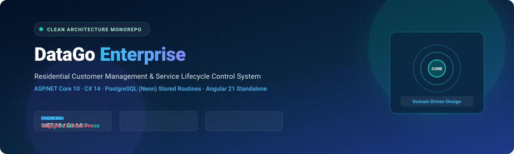
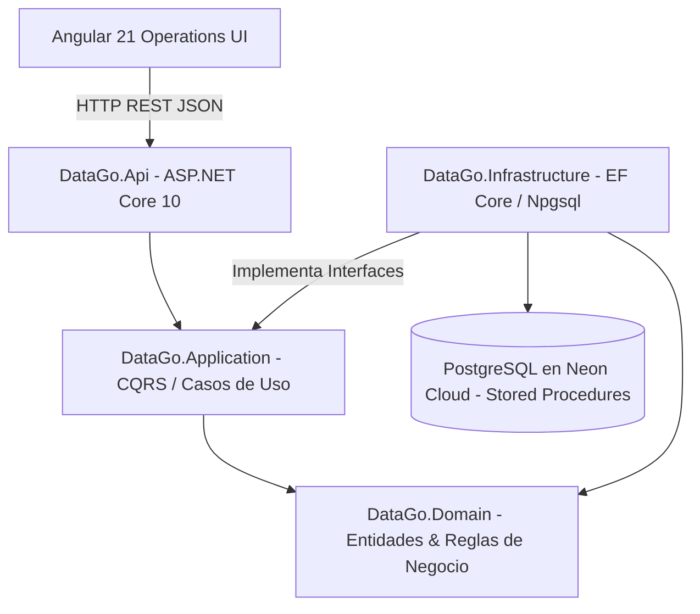

<p align="center">
  
</p>

<p align="center">
  
  
  
  
  
  
</p>

<p align="center">
  
</p>

## 🏢 Visión General del Proyecto

**DataGo (PT Monorepo)** es una solución empresarial diseñada bajo los principios de **Clean Architecture** y **Domain-Driven Design (DDD)** para la gestión, auditoría y control del ciclo de vida de clientes residenciales y contratos de servicios.

La solución desacopla estrictamente las reglas de negocio de la infraestructura y el transporte HTTP. La persistencia relacional se ejecuta a través de rutinas almacenadas (*PostgreSQL Stored Procedures & Functions*) versionadas bajo código, complementadas con **Entity Framework Core 10** y **Npgsql**, mientras que el frontend operativo está construido con **Angular 21** empleando formularios reactivos y componentes independientes.

---

## 🏛️ Arquitectura por Capas (Clean Architecture)



### Descripción de Capas:
1. **`DataGo.Domain`:** Entidades nucleares, Value Objects, enumeraciones de estado y validaciones invariantes puras (sin dependencias externas).
2. **`DataGo.Application`:** Orquestación de casos de uso (creación, búsqueda, actualización y retiro lógico de clientes residenciales).
3. **`DataGo.Infrastructure`:** Implementación de persistencia relacional, mapeo de funciones PostgreSQL mediante EF Core / Npgsql y logging estructurado.
4. **`DataGo.Api`:** Controladores RESTful, middleware global de excepciones, inyección de dependencias y contratos OpenAPI / Swagger.
5. **`frontend/`:** Interfaz de usuario construida en Angular 21 con Reactive Forms y validación asíncrona.

---

## 💾 Persistencia & Rutinas Almacenadas en PostgreSQL

A diferencia de los enfoques ORM monolíticos convencionales, DataGo versiona sus rutinas de base de datos en `docs/stored-routines/`:
- **Creación Segura:** Inserción transaccional con validación de unicidad de documento de identidad.
- **Búsqueda Avanzada:** Consultas optimizadas con paginación y filtros multi-campo.
- **Retiro Lógico:** Inactivación con sellado de fecha y motivo sin pérdida de historial.

Documentación técnica detallada:
- [Especificación de Arquitectura](docs/architecture.md)
- [Modelo de Base de Datos y Diccionario](docs/database.md)
- [Registro de Decisiones Arquitectónicas (ADR)](docs/decisions.md)

---

## 🚀 Configuración y Puesta en Marcha

### Prerrequisitos
- **.NET SDK:** `10.0.x`
- **Node.js:** Versión 20.x o 22.x LTS
- **PostgreSQL / Neon Database:** Instancia accesible

### 1. Configurar Secretos de Usuario (.NET User Secrets)
El backend utiliza `dotnet user-secrets` para aislar cadenas de conexión sin exponer credenciales:
```powershell
dotnet user-secrets set "ConnectionStrings:DefaultConnection" "Host=<host>;Port=5432;Database=<database>;Username=<user>;Password=<password>;SSL Mode=Require" --project .\backend\src\DataGo.Api\DataGo.Api.csproj
```

### 2. Compilar la Solución y Aplicar Migraciones
```powershell
# Restaurar y compilar
dotnet restore .\backend\DataGo.sln
dotnet build .\backend\DataGo.sln --no-restore

# Aplicar migraciones / rutinas a la base de datos
$env:ASPNETCORE_ENVIRONMENT = "Development"
dotnet ef database update --project .\backend\src\DataGo.Infrastructure\DataGo.Infrastructure.csproj --startup-project .\backend\src\DataGo.Api\DataGo.Api.csproj
```

### 3. Iniciar el Backend API
```powershell
dotnet run --project .\backend\src\DataGo.Api\DataGo.Api.csproj
```
- **Swagger UI:** `http://localhost:5000/swagger`
- **Health Check:** `http://localhost:5000/api/health`

### 4. Iniciar el Frontend (Angular 21)
En una segunda terminal:
```powershell
cd frontend
npm install
npm run start
```
La aplicación web estará disponible en `http://localhost:4200`.

---

## 🧪 Pruebas Unitarias y de Integración

```powershell
# Ejecutar suite de pruebas con xUnit
dotnet test .\backend\DataGo.sln --logger "console;verbosity=normal"
```

---

## 📁 Estructura del Monorepo

```text
PT/
├── backend/
│   ├── src/
│   │   ├── DataGo.Domain/           # Reglas de negocio e invariantes
│   │   ├── DataGo.Application/      # Casos de uso y DTOs
│   │   ├── DataGo.Infrastructure/   # Npgsql, EF Core y Stored Procedures
│   │   └── DataGo.Api/              # Controladores REST y Swagger
│   ├── tests/                       # Suite de pruebas automatizadas xUnit
│   └── DataGo.sln
├── docs/
│   ├── images/
│   │   ├── banner.svg               # Hero banner vectorial
│   │   └── divider.svg              # Separador decorativo
│   ├── stored-routines/             # Scripts SQL de rutinas almacenadas
│   ├── architecture.md              # Blueprint arquitectónico
│   └── database.md                  # Esquema relacional
├── frontend/                        # Cliente Angular 21 Standalone
└── README.md
```

---

## 👨‍💻 Autor y Contacto

Desarrollado por **Santiago Ospina Arango**  
- **GitHub:** [@santi-osp](https://github.com/santi-osp)  
- **Especialidad:** .NET Core / C# · Clean Architecture · Angular Enterprise

---

<p align="center">
  <sub>DataGo Enterprise · Construido con estándares de calidad de software y arquitectura limpia.</sub>
</p>